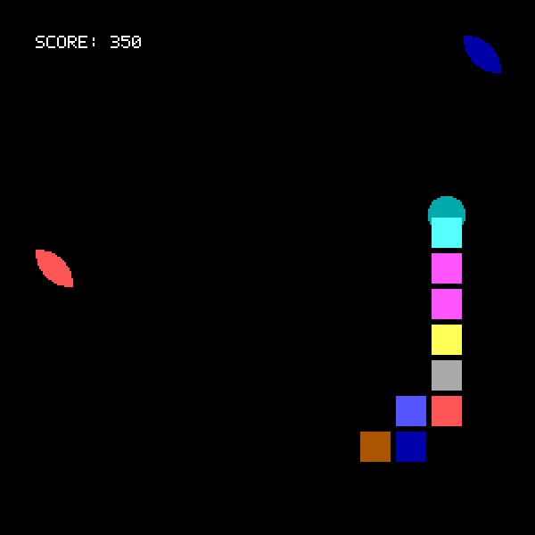
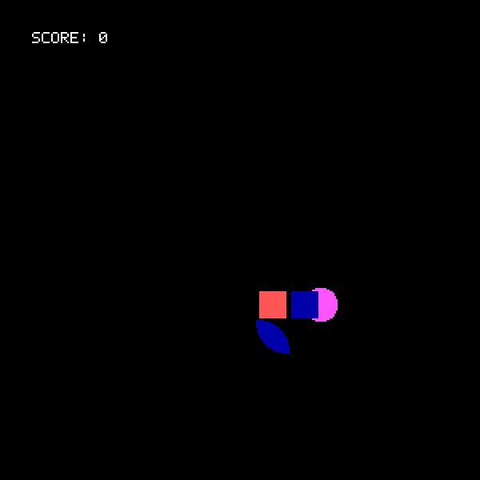

# Snake

A Nokia-style snake, written by Pranav Prem as a computer-graphics practical at Goa College of Engineering. The first commit is from November 2013, during third-year engineering. The last update before this refresh was October 2016.

The assignment was to recreate one of the first mobile games with Borland's `graphics.h`, and to have something to show for the graphics practicals. The snake eats leaves. The original notes called it a vegan snake.



## How it plays

The board is a 15×15 grid. Each cell is 20 pixels, so the picture is 300×300, shown in a window twice that size so the pixels stay chunky.

- **W A S D** or the arrow keys steer. Esc, or closing the window, quits.
- Leaves appear on their own. Eating one grows the snake, adds 50 points, and speeds the game up.
- Running into a wall or into your own body loses.
- Growing past 10 segments wins. That is 11 segments in all, eight leaves from the starting length of three, and a score of 400.

Movement starts at one cell per second (`delay(1000 - score)`). Each leaf shaves 50ms off that wait. Past a score of 900 the wait would drop to 100ms, which a normal game never reaches because it ends at 400.

You lose as soon as it happens, and the window waits for a key. The banners are the original strings: `LOSER SNAKE` and `VICTORIOUS SNAKE`.



## How it works

The screen is a grid. Every function takes a cell coordinate and paints inside that square.

The snake is an array of segments. Each segment remembers the direction it is traveling (1 right, 2 down, 3 left, 4 up; screen y grows downward). A keypress does not turn the whole snake. It stores the head's current cell and the new direction in a cache. On later frames, any segment standing on that cell picks the direction up. When the tail reaches the cell, the turn has moved through the whole body and the cache entry is dropped. That is the whole movement model.

The head is a filled circle centered on the back edge of its cell, which is what makes the direction readable. The body is a smaller square in each cell. A leaf is two quarter-circle arcs, one from each corner of the cell, filled in. Colors are chosen at random each frame from the old 16-color palette, skipping black, which is why the snake and the leaves flicker. The score is drawn in white. The default `graphics.h` font only has capitals, so `Score:` is drawn as `SCORE:`.

## Running it today

The 2016 project was built in Dev-C++ against WinBGIm (`-lbgi -lgdi32 -lcomdlg32 -luuid -loleaut32 -lole32`). `graphics.h` was already awkward on Windows 10 when the original README was written, and it is not a current way to build this. The drawing calls are unchanged in spirit. `compat/graphics.h` is a small SDL2 implementation of the ones this game actually uses.

Tested on Ubuntu 24.04 with g++ 13 and SDL 2.30.0. Any C++17 compiler and SDL2 2.0.10 or newer should be enough. Linux is what CI covers.

```bash
sudo apt install g++ make pkg-config libsdl2-dev
make
./SnakeGame
```

Other entry points:

```bash
make test          # logic tests, drawing tests, a headless smoke frame
make demo          # the snake plays itself
make format        # clang-format (the style in .clang-format)
./SnakeGame --help
```

Useful switches:

| Command or variable | What it does |
| --- | --- |
| `--demo` | Play by itself. The default seed is 1, which reaches a win. |
| `--seed N` | Fix the random seed. A normal launch is seeded from the clock. |
| `--frames N` | Stop after N movement frames. |
| `--smoke` | Draw the starting snake once and exit. |
| `SDL_VIDEODRIVER=dummy` | Run the smoke test or the demo with no display. |
| `SNAKE_FAST=1` | Cap the frame delay at 40ms. |
| `SNAKE_GRID=1` | Draw the debug grid the original code left commented out. |
| `SNAKE_DUMP_FRAMES=dir` | Write each presented frame as a BMP. |
| `SNAKE_TRACE=1` | Print the head position, score, and length each frame. |

## Tech stack

- C++17
- SDL2 for the window, the pixels, and the keyboard
- A 5×7 bitmap font, standing in for the `graphics.h` default font
- Make
- No package manager beyond the system SDL2 library. CI installs `g++`, `make`, `pkg-config`, `libsdl2-dev`, and `clang-format` on Ubuntu 24.04.

## Project structure

```
Snake.cpp                 Game loop, keyboard, and the self-playing demo
snake_logic.hpp           Board size, directions, and the rules
snake_logic.cpp
snake_draw.hpp            Leaf, head, body, score, and the end banner
snake_draw.cpp
compat/graphics.h         The graphics.h calls this game uses
compat/graphics.cpp       SDL2 implementation of that subset
compat/conio.h            kbhit and getch, reading the SDL window
tests/test_logic.cpp      Movement, collisions, fruit, the turn cache
tests/test_graphics.cpp   Lines, flood fill, the leaf, text
docs/                     Screenshot and gif
SnakeGame.dev             The original Dev-C++ project file
Makefile
.github/workflows/ci.yml
AGENTS.md                 Notes for anyone (or any agent) changing the code
```

`SnakeGame.dev` is only a record of the 2016 build. Nothing compiles it.

## What this refresh changed

The 2016 tree could not be built here. It also shipped a 32-bit Windows `SnakeGame.exe` and a `Snake.o`. Both were build output and are no longer in the tree. Git history still has them.

A few behaviors were wrong in the source, and those are fixed:

- The head color skipped blue and allowed black, so the head sometimes disappeared into the background. It now skips black, like the body and the leaves.
- Only the first leaf was tested against the head. Later leaves were compared with the wrong segment.
- A leaf could be placed on column or row 15, which is already outside the wall.
- Winning or losing broke out of the inner loop and then kept playing. `check` was never cleared. The game now stops, and the banner stays up in the middle of the window until you press a key.
- `itoa` and a 10-byte `strcat` buffer were how the score was drawn. That is not portable, and `Score: 400` did not fit.
- `srand` was never called, so every launch was the same game.
- A second key pressed before the snake moved could queue a reversal of a turn that had not happened yet. The original checks were trying to forbid reversing. They now apply to the latest queued direction as well.

Arrow keys and capital WASD are accepted. They map to the same directions as the original lowercase keys.

## Left alone on purpose

The grid, the cell size, the turn cache, the rainbow flicker, the leaf made of two arcs, the head circle on the trailing edge, the score of 50, the win at more than 10 segments, and the `delay(1000 - score)` timing are the game. Leaves can still appear on top of the snake. There is no menu and no high-score file. No license file was added.
